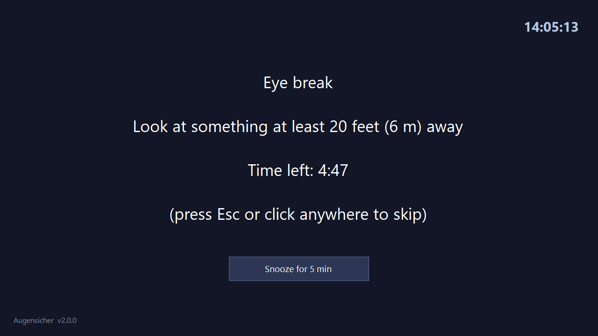
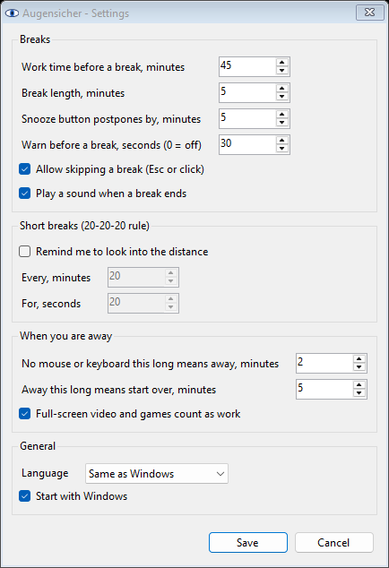

# Augensicher

A small Windows program that reminds you to rest your eyes. After every
45 minutes at the computer it dims all your screens for a 5-minute break.
Time you spend away from the computer does not count.

One exe, nothing to install, no account, no internet. English and Russian.

[Русская версия](README.ru.md) · Free, as is, at your own risk: read
[DISCLAIMER.md](DISCLAIMER.md) before relying on it. Not medical advice.

<p align="center">
  
</p>

## What it does

- **Counts only real work.** The timer runs while you use the mouse or
  keyboard. Two minutes without input and it stops; away for more than five
  minutes and it starts over, because your eyes have rested anyway.
- **Knows when you are not there.** A locked screen (Win+L), a display that
  has turned off, or a computer that went to sleep count as away at once,
  without waiting.
- **Knows when you are watching.** A full-screen video or game counts as
  work even if the mouse does not move.
- **Warns first.** A notification 30 seconds before the break, so you can
  finish your sentence.
- **Covers every monitor** with a dark screen, a tip ("Look at something at
  least 20 feet away"), a countdown and a clock. Press Esc or click to skip,
  or *Snooze* to get 5 more minutes.
- **Short breaks, if you want them.** The 20-20-20 rule: every 20 minutes,
  look 20 feet away for 20 seconds. A small window that does not take the
  focus, so typing is not interrupted. Off by default.
- **Pause** for 30 minutes, 1 or 2 hours, or until tomorrow: for a call or a
  presentation.

Everything is in the menu of the eye icon next to the clock (right-click it).
Double-click the icon to see how long until the next break.

## Download and run

1. Open the [releases page](https://github.com/schwarzmeewolf/augensicher/releases)
   and download `Augensicher-<version>-windows.zip`.
2. Unpack it anywhere, for example into `Documents\Augensicher`.
3. Double-click `Augensicher.exe`. An eye appears next to the clock.
4. To start it with Windows, right-click the eye and tick *Start with Windows*.

**Windows may warn you** with "Windows protected your PC". The exe is not
signed with a paid certificate, and SmartScreen warns about every such
program it has not seen often. Click *More info*, then *Run anyway*. Only do
this for a copy from the releases page above.

To remove it: untick *Start with Windows*, choose *Exit*, and delete the
folder. Settings are in `%APPDATA%\Augensicher`; delete that folder too if
you like.

### Requirements

Windows 10 or 11. The program needs .NET Framework 4.x, which every Windows 10
and 11 already has. No administrator rights.

## Settings

Right-click the eye, then *Settings...*.

<p align="center">
  
</p>

| Setting | Default | What it means |
|---|---|---|
| Work time before a break | 45 min | Minutes of actual work, not of clock time |
| Break length | 5 min | |
| Snooze button postpones by | 5 min | Minutes of work until the break comes back |
| Warn before a break | 30 s | 0 turns the warning off |
| Allow skipping a break | on | Off: Esc, click and Alt+F4 do nothing; only *Snooze* works |
| Play a sound when a break ends | on | Not after a break the computer slept through |
| Short breaks | off | Every 20 min, for 20 s |
| No mouse or keyboard this long means away | 2 min | The timer stops |
| Away this long means start over | 5 min | The timer goes back to zero |
| Full-screen video and games count as work | on | |
| Language | same as Windows | English or Russian |

The settings are a plain text file, `%APPDATA%\Augensicher\settings.ini`, which
you can also edit in Notepad. Values out of range are corrected, and a broken
file never stops the program; it falls back to the defaults.

**Scripted setup.** `Augensicher.exe --autostart on` (or `off`) does what the
*Start with Windows* menu item does, and exits.

**Portable copy.** Put an empty `settings.ini` next to `Augensicher.exe`, and
the program keeps its settings and log in that folder instead, for example on
a USB stick.

## Privacy

Augensicher asks Windows only four things: how long since the last mouse or
keyboard input (not which keys), whether the screen is locked, whether the
display is on, and whether the window in front covers its monitor. It does
not read what you type or what is on the screen, and it has no network code
at all. The log (`augensicher.log`) holds start-up, settings, breaks and
errors, nothing else.

## Something does not work

Right-click the eye, then *Support info*. The program writes
`support-info.txt` with its version, the Windows version, your screens, the
settings and the end of its log, and shows the file in Explorer. Attach it
to an [issue](https://github.com/schwarzmeewolf/augensicher/issues).

Starting `Augensicher.exe` a second time does not start a second copy: the
running one shows a notification and stays the only one.

## Build from source

No Visual Studio and no SDK: the C# compiler that comes with Windows is
enough.

```
build.bat
```

or `powershell -ExecutionPolicy Bypass -File tools\build.ps1`. This compiles
and runs the tests (`tests\Tests.cs`), builds `dist\Augensicher\Augensicher.exe`
and packs `dist\Augensicher-<version>-windows.zip`. Add `-Screenshots` to redraw
the pictures in `assets\screenshots`. The icon is drawn by
`tools\make-icon.ps1`.

**Acceptance test on a clean Windows.** `tools\sandbox\start.ps1` runs the
built archive in Windows Sandbox: unpacks it into a folder with Cyrillic
letters and a space, starts it, starts it a second time, turns autostart on
and starts it from the shortcut, waits for a break after a minute of
simulated typing, skips one with Esc while Notepad has the focus, waits for
a short break, and checks the log for errors. It prints PASS/FAIL lines and
leaves screenshots in `C:\augensicher-sandbox\results`. Needs the Windows
Sandbox feature; takes about 15 minutes.

| File | What is in it |
|---|---|
| `src\WorkTracker.cs` | When you are working, away, and when a break is due. No Windows calls, so the tests drive it directly |
| `src\TrayApp.cs` | The tray icon, its menu, timers, breaks |
| `src\BreakForms.cs` | The break screen and the short-break window |
| `src\Native.cs` | Idle time, lock, display power, full screen, shortcuts |
| `src\I18n.cs` | Russian translations. English is the source text; a test fails if a string has no translation |
| `src\Settings.cs` | `settings.ini` |

The version lives in one place, `src\AppInfo.cs`. Changes are listed in
[CHANGELOG.md](CHANGELOG.md).

## Licence

[MIT](LICENSE). Use it, change it, share it; there is no warranty. See also
[DISCLAIMER.md](DISCLAIMER.md), in English and Russian.
