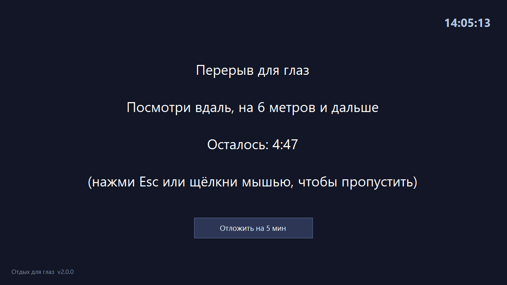
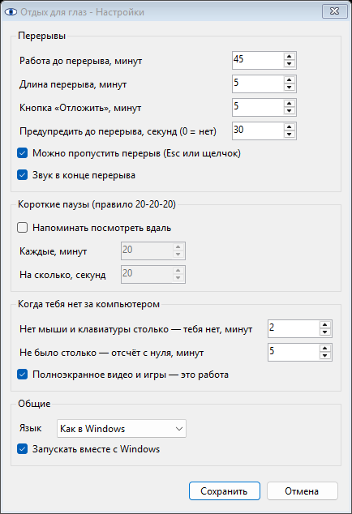

# Augensicher — отдых для глаз

Маленькая программа для Windows, которая напоминает дать глазам отдых.
Каждые 45 минут работы за компьютером она затемняет все экраны на
5-минутный перерыв. Время, когда вас нет за компьютером, не считается.

Один файл exe, ничего не нужно устанавливать, без учётной записи и без
интернета. Английский и русский интерфейс.

[English version](README.md) · Бесплатно, как есть, на свой риск: прочитайте
[DISCLAIMER.md](DISCLAIMER.md). Это не медицинский совет.

  

## Что умеет

- **Считает только работу.** Отсчёт идёт, пока вы трогаете мышь или
  клавиатуру. Две минуты без них — отсчёт стоит; не было дольше пяти минут —
  начинается заново: глаза и так отдохнули.
- **Понимает, что вас нет:** заблокированный экран (Win+L), выключенный
  монитор, спящий компьютер — это отдых, сразу, без ожидания.
- **Понимает, что вы смотрите:** полноэкранное видео или игра — это работа,
  даже если мышь не двигается.
- **Предупреждает** за 30 секунд до перерыва.
- **Закрывает все мониторы** тёмным экраном с советом, обратным отсчётом и
  часами. Esc или щелчок — пропустить, кнопка «Отложить» — ещё 5 минут.
- **Короткие паузы по правилу 20-20-20**: каждые 20 минут посмотреть вдаль
  на 20 секунд. Маленькое окно, которое не перехватывает ввод. Выключены,
  включаются в настройках.
- **Пауза** на 30 минут, 1–2 часа или до завтра — на время созвона.

Всё — в меню значка-глаза рядом с часами (правый щелчок). Двойной щелчок по
значку показывает, сколько осталось до перерыва.

## Как скачать и запустить

1. Откройте [страницу выпусков](https://github.com/schwarzmeewolf/augensicher/releases)
   и скачайте `Augensicher-<версия>-windows.zip`.
2. Распакуйте в любую папку, например `Документы\Augensicher`.
3. Дважды щёлкните `Augensicher.exe`. Рядом с часами появится глаз.
4. Чтобы программа запускалась вместе с Windows: правый щелчок по глазу →
   «Запускать вместе с Windows».

**Windows может предупредить** «Система Windows защитила ваш компьютер»:
файл не подписан платным сертификатом. Нажмите «Подробнее» → «Выполнить в
любом случае». Делайте так только для копии со страницы выпусков.

Удалить: снять галочку автозапуска, «Выход», удалить папку. Настройки лежат
в `%APPDATA%\Augensicher`.

Нужна Windows 10 или 11. Права администратора не нужны.

## Настройки

Правый щелчок по глазу → «Настройки...».

  

Настройки хранятся в обычном текстовом файле
`%APPDATA%\Augensicher\settings.ini`, его можно править и в Блокноте.
Положите пустой `settings.ini` рядом с `Augensicher.exe` — и программа будет
хранить настройки и журнал в своей папке (например, на флешке).

## Если что-то не работает

Правый щелчок по глазу → «Сведения для поддержки». Программа запишет файл
`support-info.txt` (версия, Windows, экраны, настройки, конец журнала) и
покажет его в Проводнике. Приложите его к
[обращению](https://github.com/schwarzmeewolf/augensicher/issues).

## Лицензия

[MIT](LICENSE): можно пользоваться, менять и распространять, без гарантий.
Подробнее — в [DISCLAIMER.md](DISCLAIMER.md) на русском и английском.
